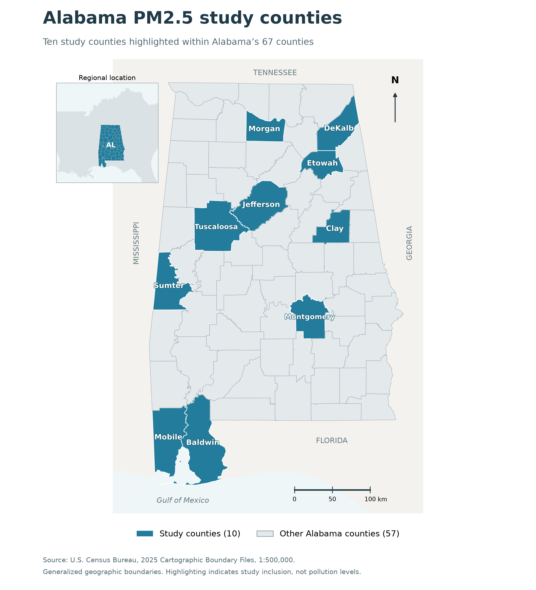

# Alabama PM2.5 study



All 67 Alabama counties are shown; the ten study counties are highlighted. [Map sources and code](PCA_SR/initial_study/study_area_map/README.md).

Daily 2025 observations from ten Alabama county-labeled monitoring series. The repository contains exploratory analyses, weather PCA, source matching, maps, neighboring-county comparisons and classical/deep-learning forecasting.

## Start here: pooled forecasting

[PCA_SR/pooled_county_study](PCA_SR/pooled_county_study/README.md) is the recommended current experiment: merged raw/clean data, separate model modules, three expanding-window validation folds, hyperparameter searches, fitted models and full-run results.

```sh
git clone https://github.com/regmi-sijan/PM2.5_Study.git
cd PM2.5_Study/PCA_SR/pooled_county_study
python3 -m venv .venv
source .venv/bin/activate
python -m pip install --upgrade pip
python -m pip install -r requirements.txt
python -m unittest -v test_pipeline.py
python verify_results.py
```

Use native ARM64 Python 3.12 on an M1 Mac. CPU execution is verified; `--device auto` probes Apple's MPS backend and falls back to CPU. To run the complete experiment again:

```sh
python run_study.py --data data/merged_counties.xlsx --device auto --output results_new
python verify_results.py --data data/merged_counties.xlsx --results results_new
```

All ten counties and the full year are processed. Missing/invalid targets are excluded rather than imputed. The saved full run used 3,650 panel rows, 3,580 observed cleaned PM2.5 values, 1,783 validation cases and 887 shared test cases, with all candidate configurations, three stochastic seeds and 1,000 bootstrap replicates. It was not a smoke run. See [full-run evidence](PCA_SR/pooled_county_study/FULL_RUN_VERIFICATION.md).

## Read results directly on GitHub

Each PDF now has an inline README summary with tables and figures:

- [Weather PCA results](PCA_SR/README.md#results-summary-at-a-glance)
- [Initial county, weather and prediction findings](PCA_SR/initial_study/README.md#results-summary-at-a-glance)
- [Current pooled classical/neural comparison](PCA_SR/pooled_county_study/README.md#results-summary-at-a-glance)

The original PDFs remain available and unchanged.

## Repository guide

| Location | Contents |
| --- | --- |
| [PCA](PCA/README.md) | Original workbook and R PCA workflow |
| [PCA_SR](PCA_SR/README.md) | Python weather-variable PCA screening |
| [initial_study](PCA_SR/initial_study/README.md) | Seven exploratory analyses and historical prediction results |
| [earlier model comparison](PCA_SR/initial_study/07_prediction/model_comparison/README.md) | Earlier six-model experiment with a single validation period |
| [study area map](PCA_SR/initial_study/study_area_map/README.md) | Census county boundaries and maps |
| [adjacent counties](PCA_SR/initial_study/08_adjacent_counties/REPORT.md) | Neighboring-county PM2.5 associations |
| [source findings](PCA_SR/initial_study/07_prediction/model_comparison/source_verification/SOURCE_FINDINGS.md) | EPA matching and airport weather-source investigation |
| [pooled summary PDF](PCA_SR/pooled_county_study/PM25_Pooled_County_Study_Summary.pdf) | Four-page methods and findings summary |

Source: `PCA/Meterological_data_ALAbama.xlsx`. Analysis copy: `PCA_SR/Meterological_data_ALAbama_copy.xlsx`. Combined workbook: `PCA_SR/pooled_county_study/data/merged_counties.xlsx`. Raw source measurements are preserved.

## Findings and limits

LSTM led selected validation MAE (1.876 micrograms/m³). CNN-LSTM led exploratory test MAE (2.113), followed by LSTM (2.133); persistence was 2.478. The hybrid-versus-LSTM interval crossed zero. Persistence performed better on the 27 high-pollution test cases. Read the [complete findings](PCA_SR/pooled_county_study/STUDY_RESULTS_AND_CONCLUSIONS.md).

Only one year is available. Test months were examined earlier, so evaluation is exploratory. County dependence, reused weather and incomplete weather provenance limit interpretation. These are monitor-site observations, not county-wide exposure estimates. Source matching supports PM2.5 units but does not establish all original processing or redistribution terms; no new secondary-data license is asserted.

## Reproduce earlier analyses

Install each workflow's own requirements in a separate environment.

```sh
# From repository root, after installing PCA_SR/requirements.txt
python PCA_SR/pca_variable_ranking.py PCA/Meterological_data_ALAbama.xlsx --output PCA_SR/results_reproduced
# After installing PCA_SR/initial_study/requirements.txt
cd PCA_SR/initial_study
python study.py --study all
python verify.py
```

Initial-study runs overwrite generated outputs. They retain negative concentrations with sensitivity checks; the pooled study marks them missing, so counts differ. Other workflows document commands in their folders. See [GitHub update instructions](GITHUB_UPDATE.md) to review, commit and push this update.
